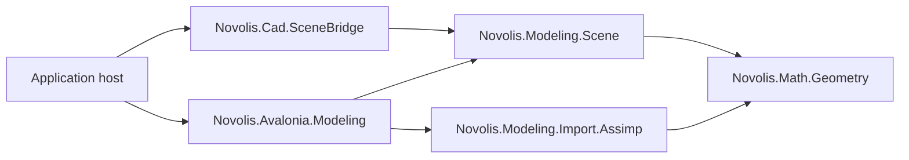

# Modeling design

## Layer placement

`novolis-modeling` is an Avalonia-free orthogonal library island. It may depend on
`Novolis.Math.Geometry` and third-party asset-format libraries. It must not
depend on Avalonia, rendering, Raylib, simulation, CAD, or application hosts.

## Package responsibilities

### `Novolis.Modeling.Scene`

Owns the renderer-neutral scene document, hierarchy, transforms, mesh
instances, materials, lights, cameras, staged evaluation, editing state, and
`.nov3djson` serialization. Evaluation produces `Novolis.Math.Geometry`
values; it does not create GPU or renderer objects.

### `Novolis.Modeling.Import.Assimp`

Owns translation from Assimp-supported external assets into Geometry meshes
and Modeling-compatible skin data. It contains no UI or renderer policy.

### Geometry ownership

Mesh storage and algorithms remain in `Novolis.Math.Geometry`: booleans,
welding, splitting, topology, primitive tessellation, and geometric picking.
Modeling composes those operations into a scene; it does not create a duplicate
mesh-algorithm façade.

`Novolis.Modeling.Scene` owns the evaluated mesh boundary. `EvaluatedMesh`
retains the existing position/index/world contract and adds optional normals,
tangents, UVs, material slots, curvature, cavity, topology, adjacency, bounds,
LOD, quality, readiness, and deterministic metadata. `MeshAttributeGenerator`
provides deterministic CPU normal, tangent, UV, curvature, and cavity passes;
the generated values remain renderer-neutral.

`MeshQualityProfile` controls which optional values are generated and whether
topology/adjacency and a deterministic LOD reduction are requested.
`MeshEvaluationMetadata` separates geometry hashes from full semantic hashes and
includes the contract, mesher, modifier, quality, LOD, and attribute inputs in
the cache identity. Local geometry hashes intentionally exclude source IDs and
world placement.

Readiness is split into geometry and appearance stages. A mesh can be
geometry-ready while an intentionally reduced quality profile omits normals or
UVs. `MeshContractValidator` derives available attributes from actual arrays
and topology, so appearance-only operations cannot report omitted geometry or
silently claim a geometry change.

## Document authority

Generic 3D products may author and persist `SceneDocument`. CAD and ship
products author `CadDocument` and derive a `SceneDocument` through
`Novolis.Cad.SceneBridge`. The CAD projection is one-way in this boundary;
scene-to-CAD round-tripping is not implied.

Renderer conversion belongs to a renderer-owned adapter or an application
composition root. The scene package must not contain renderer-shaped DTOs.
